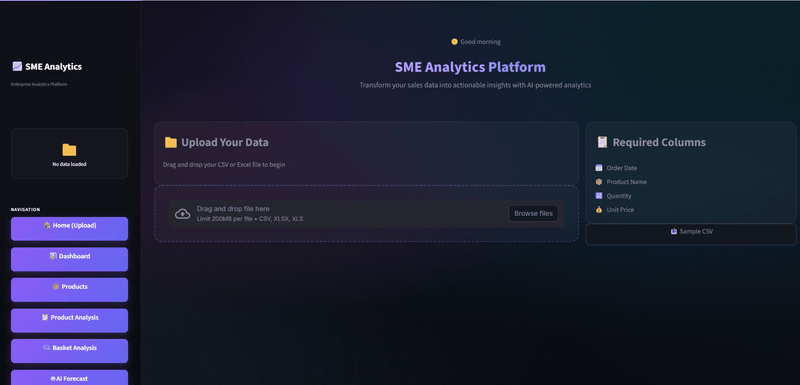

# 📈 Integrated Sales Analytics Platform for SMEs




A web-based analytics platform designed to help small-to-medium e-commerce enterprises transform raw transactional data into actionable business intelligence. 

Built with a focus on privacy-by-design and intuitive UX, this platform requires zero coding knowledge from the end-user. Simply upload a sales CSV, and the system automatically cleans, maps, and models the data.

## ✨ Core Modules

* 📊 **Interactive KPI Dashboard:** Real-time metrics, dynamic date filtering, and automated revenue trend visualizations.
* 📦 **ABC Inventory Analysis:** Automated product classification to prioritize high-value stock.
* 🛒 **Market Basket Analysis:** Utilizes the Apriori algorithm and interactive network graphs to discover cross-selling and bundling opportunities.
* 🤖 **AI Sales Forecasting:** Machine learning models that predict future revenue trends with automated fallback degradation.
* 👥 **Customer Segmentation (RFM):** Automatically groups customers into actionable cohorts (Champions, At-Risk, Lost) based on Recency, Frequency, and Monetary value.
* 💬 **AI Assistant:** A Gemini-powered natural language interface to chat directly with your sales data.
* 📄 **Automated PDF Reporting:** One-click generation of comprehensive, boardroom-ready reports with embedded Matplotlib charts.

## 🛠️ Technology Stack

* **Frontend:** Streamlit (Custom CSS Dark Theme)
* **Data Processing:** Pandas, NumPy
* **Machine Learning:** Scikit-Learn, MLxtend (Frequent Pattern Mining)
* **Visualization:** Plotly Express, Plotly Graph Objects, Matplotlib, NetworkX
* **Reporting:** ReportLab
* **LLM Integration:** Google Generative AI (Gemini)

## 🚀 Installation & Setup

**1. Clone the repository**
```bash
git clone https://github.com/abdulmale3k/Integrated-_Sales_Analytics_Platform.git
cd Integrated-_Sales_Analytics_Platform
```

**2. Create and activate a virtual environment**
```bash
python -m venv venv
source venv/bin/activate  # On Windows: venv\Scripts\activate
```

**3. Install dependencies**
```bash
pip install -r requirements.txt
```

**4. Configure API Keys**
To use the AI Assistant and advanced forecasting features, you must provide a Gemini API key.
Create a folder called `.streamlit` in the root directory, then create `secrets.toml` inside it:
```toml
GEMINI_API_KEY = "your_api_key_here"
```
If deploying on Streamlit Community Cloud, add your key in App Settings, Secrets instead.

**5. Launch the Application**
```bash
streamlit run app.py
```

## 📁 Data Format Requirements
The platform accepts `.csv`, `.xls`, and `.xlsx` files. The automated data pipeline will attempt to auto-detect columns, but your dataset should ideally contain:
* `Order Date`
* `Product Name`
* `Quantity`
* `Unit Price`
* `Transaction ID` (Optional, but required for Market Basket Analysis)
* `Customer ID` (Optional, but required for RFM Segmentation)

## 📝 License
This project is licensed under the MIT License.